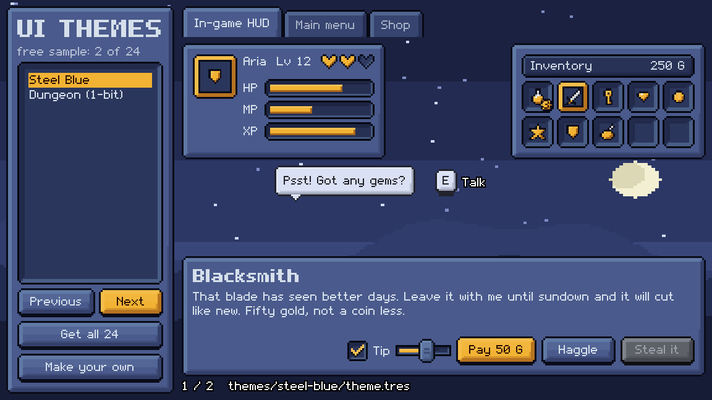
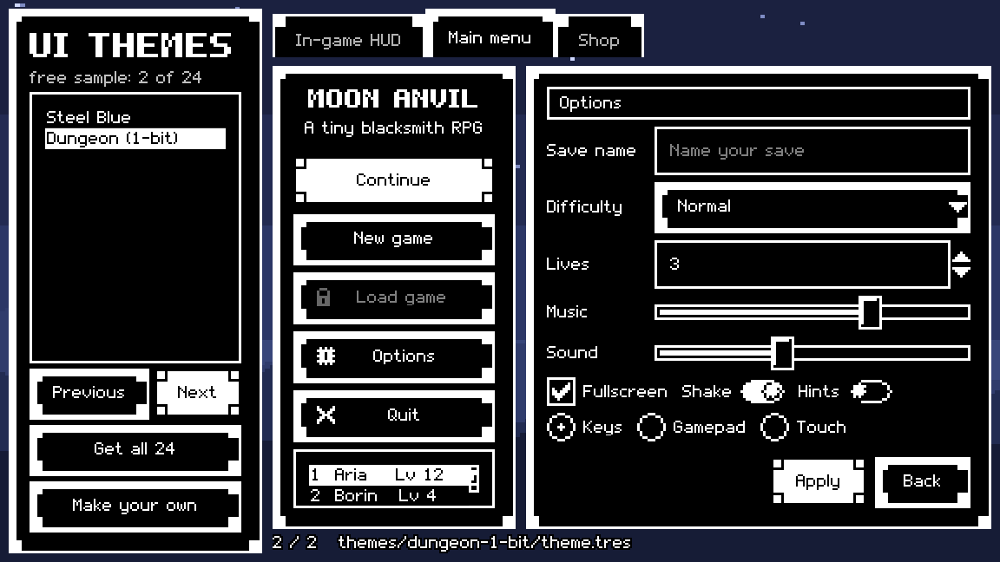
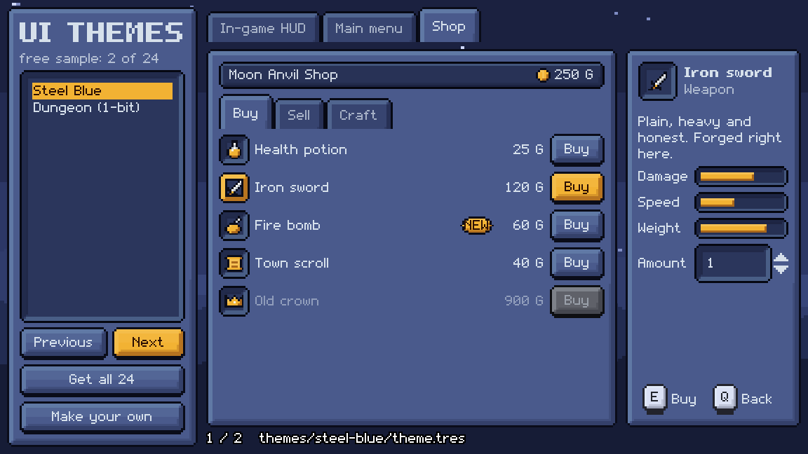

# Kitsmith UI Themes - Free Sample

Two complete pixel-art UI themes for Godot 4 (and, as plain PNG files, for any engine), free and
MIT-licensed:

- **Steel Blue**: a classic blue RPG interface with a gold accent.
- **Dungeon (1-bit)**: the same kind of kit drawn with two colours only, black and white.

Each theme is 80 pieces, a pixel font in three faces and a **Godot 4 Theme in a single file**:
copy `theme.tres` into your project, set it on your root Control, and your buttons, check boxes,
sliders, progress bars, tabs, lists, text fields and popups are skinned.





These are 2 of the 24 themes of the **Kitsmith UI Themes Pack**, and they were made with
**Kitsmith**, a generator of pixel-art UI kits (choose a border, two colours and a pattern, or
lock the kit to your own palette). Both will be on itch.io: https://cesarlars.itch.io (pages
coming soon).

## Try it

This folder is a Godot 4 project. Open it in Godot (Import > select `project.godot`) and press F5:
an in-game HUD, a main menu and a shop made of plain Godot controls, and a list to switch between
the two themes. `demo/demo.gd` is short and commented: it shows the one line that applies a theme
and how each piece is used. Made and tested with Godot 4.7.2; older 4.x versions are untested.

## What is in each theme

```
themes/<theme>/
  theme.tres         Godot 4 Theme with its textures and fonts embedded (at 3x)
  png/               80 PNG files, one per piece (at 3x: one kit pixel is three screen pixels)
  kit.png            all the pieces in one sprite sheet
  kit.json           frame rectangles and 9-slice margins of every piece, and the palette
  font.png/.fnt      the pixel font: atlas + BMFont text file
  font_bold.png/.fnt       the bold face
  font_outline.png/.fnt    white with a black edge, for text over the game world
  palette.png/.hex   the colours of the theme
  kit.css            CSS classes (border-image) for HTML games and tools
  preview.html       a small page that shows kit.css at work
  preview.png        a mock window made with the theme
```

The pieces: panel, header strip, inventory slot, hollow frame, speech bubble with tail,
separator; buttons in 4 states, a primary button in the accent colour with the same 4 states, a
focus ring and a key cap; check box, radio button, toggle switch, slider, scroll bar, tabs;
progress bar, badge, mouse cursor, 4 arrows; 21 item icons and 23 interface glyphs.

The font is a proportional 5x7 face with 153 glyphs: ASCII plus the accented letters and signs of
Spanish, Portuguese, German, Italian and French (French without the œ and æ ligatures and ÿ).

## In Godot 4

1. Copy one `theme.tres` anywhere into your project. It is self-contained.
2. Select your root `Control` and set **Theme** to that file.
3. For crisp pixels set **Project Settings > Rendering > Textures > Default Texture Filter** to
   **Nearest**.

Type variations (Inspector > Theme > Type Variation): `AccentButton` (Button), `Header` +
`HeaderLabel`, `SpeechBubble` + `BubbleLabel`, `PortraitFrame` (Panel), `KeyCap`, `Badge`,
`TitleLabel` and `OutlineLabel` (Label). Inventory slots, icons and glyphs are loose PNG files:
see `_slot_box()` and `_icon()` in `demo/demo.gd`.

## In other engines

Use the PNG files. Each frame in `kit.json` has a `slice` with the `left`, `top`, `right` and
`bottom` margins in pixels: those are the 9-slice borders. The `.fnt` files are the AngelCode
BMFont text format.

## Tests

```
godot --headless --path . --script res://tools/run_tests.gd
```

## Licence

MIT, see `LICENSE`. Use the two themes in any project, free or commercial.

## How this was made

The art and the font are procedural: drawn pixel by pixel by a deterministic program (Kitsmith),
not by an image-generating AI model. This repository is maintained by an AI agent (Rock) that
operates the project for a real person; the code of the generator and of this demo was written
by that agent and is covered by automated tests. Issues are welcome and are answered by the agent.
